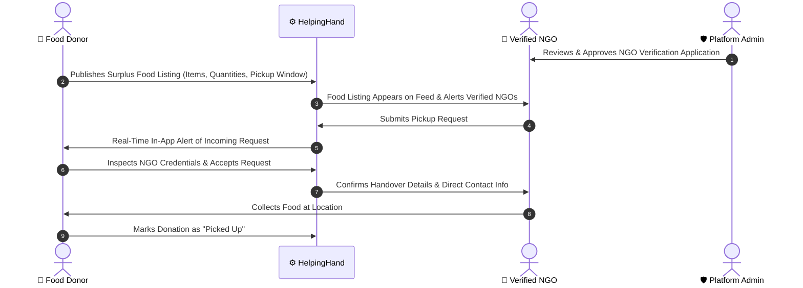

# 🤝 HelpingHand

<p align="center">
  <strong>A Community-Driven Food Redistribution & Surplus Donation Platform</strong>
</p>

<p align="center">
  
  
  
  
  
  
</p>

---

## 📖 Overview

**HelpingHand** connects food donors (households, restaurants, event organizers, caterers) with verified charitable organizations, shelters, and community kitchens to eliminate edible food waste and combat hunger.

The project is structured into two dedicated applications sharing a central database:
1. **Main Web (`mainweb/`)**: Dual-role public portal for food donors and verified NGOs.
2. **Admin Portal (`admin/`)**: Back-office operations interface for NGO credential verification, moderation, and fraud prevention.

---

## 🏛️ System Architecture & Ports

```
HelpingHand/
├── mainweb/                  # Donor & NGO Public Platform
│   ├── client/               # React 18 SPA (Port 3000)
│   └── server/               # Express 5 REST API (Port 5000)
│
└── admin/                    # Platform Admin & Moderation
    ├── client/               # React 18 SPA (Port 3001)
    └── server/               # Express 5 REST API (Port 5001)
```

| Component | Layer | Port | URL / Health Check | Description |
|---|---|:---:|---|---|
| **Main Web Client** | Frontend | `3000` | [http://localhost:3000](http://localhost:3000) | Donor & NGO dashboard, listings, and notifications |
| **Main Web Server** | Backend | `5000` | [http://localhost:5000/api/health](http://localhost:5000/api/health) | Auth, donation lifecycle, and automated expiry daemon |
| **Admin Client** | Frontend | `3001` | [http://localhost:3001](http://localhost:3001) | Administrative review, verification, and moderation |
| **Admin Server** | Backend | `5001` | [http://localhost:5001/api/admin/health](http://localhost:5001/api/admin/health) | Admin auth, analytics, and telephone blacklist APIs |
| **Database** | Storage | `27017` | `mongodb://127.0.0.1:27017/helpinghand` | Central MongoDB database |

---

## 🔄 How It Works



---

## 🌟 Main Features

### 🍱 For Food Donors
- **Itemized Multi-Item Listings**: List multiple food items in a single post with custom quantities and units (`portions`, `kg`, `packets`, `pieces`, `litres`).
- **Dietary & Safety Details**: Categorize by dietary type (`veg`, `nonveg`, `mixed`) with precise pickup windows (`pickupFrom`, `pickupTo`) and expiration deadlines.
- **Request Management**: Inspect requesting NGOs (verification status, coordinator name, contact) and choose to **Accept** or **Decline**.
- **Handover Control**: Re-open/release a listing back to `available` if an NGO does not show up, or mark as `pickedUp` upon completion.
- **Real-Time Notifications**: Instant alerts for incoming requests, confirmations, and updates.
- **History & Tracking**: View active donations and past completed handovers.

### 🏢 For Verified NGOs
- **Verified Status Badge**: Apply for verified NGO status with organization and coordinator credentials.
- **Smart Food Feed**: Browse available surplus food filtered by city and dietary preference.
- **One-Click Requests**: Place pickup requests directly on available listings.
- **Direct Coordination**: Immediate access to donor phone and address once accepted.

### 🛡️ For Platform Administrators
- **Executive Analytics**: Real-time stats on registered donors, verified NGOs, pending applications, active listings, and completed handovers.
- **NGO Verification Pipeline**: Review organization credentials, coordinator phone, and address; **Approve**, **Reject**, or reset to **Pending** with timestamped audit notes.
- **User Directory**: Search, inspect, edit, or delete registered donor and NGO accounts.
- **Fraud Prevention & Phone Blacklist**: Suspend bad actors with a mandatory audit reason. Blacklisted phone numbers are automatically blocked from future registrations.

---

## 🛠️ Technology Stack

- **Frontend**: React 18, React Router v6, Bootstrap 5, Lucide React, React Hot Toast, Axios
- **Backend**: Node.js (v18+), Express 5, Mongoose 9, JWT (`jsonwebtoken`), bcryptjs
- **Database**: MongoDB
- **Background Jobs**: `node-cron` (auto-expires uncollected food listings past pickup deadlines)

---

## ⚙️ Environment Configuration

Ensure each module has its `.env` file configured:

### 1. Main Web Backend (`mainweb/server/.env`)
```env
PORT=5000
MONGO_URI=mongodb://127.0.0.1:27017/helpinghand
USER_JWT_SECRET=helpinghand_dev_secret_change_me
```

### 2. Main Web Frontend (`mainweb/client/.env`)
```env
PORT=3000
REACT_APP_API_URL=http://localhost:5000
BROWSER=none
```

### 3. Admin Backend (`admin/server/.env`)
```env
PORT=5001
MONGO_URI=mongodb://127.0.0.1:27017/helpinghand
ADMIN_JWT_SECRET=helpinghand_admin_dev_secret_change_me
ADMIN_PASSWORD=admin123
ADMIN_PASSWORD_HASH=
```
*(Leave `ADMIN_PASSWORD_HASH` blank to auto-hash `ADMIN_PASSWORD` on startup)*

### 4. Admin Frontend (`admin/client/.env`)
```env
PORT=3001
REACT_APP_API_URL=http://localhost:5001
BROWSER=none
```

---

## 🚀 Quick Start Guide

### Prerequisites
- [Node.js](https://nodejs.org/) (v18+)
- [MongoDB](https://www.mongodb.com/) running locally on port `27017`

### 1. Install Dependencies
```bash
# Main Web
cd mainweb/server && npm install
cd ../client && npm install

# Admin Portal
cd ../../admin/server && npm install
cd ../client && npm install
```

### 2. Start Services
Run each service in a separate terminal:

```bash
# Terminal 1: Main Web Backend (Port 5000)
cd mainweb/server && npm run dev

# Terminal 2: Main Web Frontend (Port 3000)
cd mainweb/client && npm start

# Terminal 3: Admin Backend (Port 5001)
cd admin/server && npm run dev

# Terminal 4: Admin Frontend (Port 3001)
cd admin/client && npm start
```

- **Main Web**: [http://localhost:3000](http://localhost:3000)
- **Admin Panel**: [http://localhost:3001](http://localhost:3001) *(Default password: `admin123`)*

